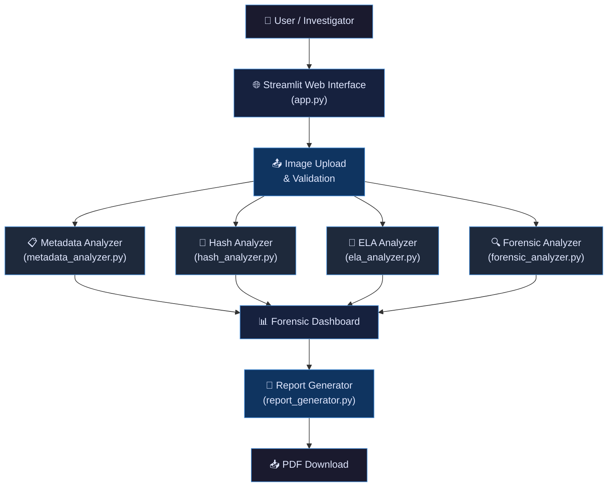

# 🛡️ ImageShield — Digital Image Forensics and Integrity Analysis

> A web-based digital forensics tool for analyzing digital images, inspecting metadata, verifying file integrity, and generating professional forensic reports.

---

## 📌 Abstract

**ImageShield** is a Python-based digital image forensics tool designed for preliminary analysis of digital photographs. It provides investigators, students, and security professionals with a user-friendly web interface to examine image metadata, compute cryptographic hashes for integrity verification, perform Error Level Analysis (ELA) for detecting potential manipulations, and generate comprehensive PDF reports. The tool emphasizes transparency and responsible reporting — it provides forensic indicators rather than definitive judgments.

---

## 🎯 Problem Statement

Digital images are routinely used as evidence in legal proceedings, journalism, insurance claims, and social media. However, images can be easily manipulated using widely available editing software. Detecting such manipulation is challenging because:

- Modern editing tools can produce visually convincing forgeries.
- Image metadata can be stripped, modified, or fabricated.
- Multiple rounds of compression and format conversion obscure evidence of editing.
- Manual forensic examination is time-consuming and requires specialized expertise.

There is a need for accessible, automated tools that can perform preliminary forensic screening and assist investigators in identifying images that warrant further examination.

---

## 🎯 Objectives

1. **Metadata Extraction:** Extract and display all available EXIF metadata, including camera details, timestamps, GPS coordinates, and software information.
2. **Integrity Verification:** Compute SHA-256 cryptographic hashes and compare files to verify byte-level identity.
3. **Error Level Analysis:** Implement ELA to visualize potential manipulation indicators in JPEG images.
4. **Consistency Analysis:** Provide supplementary visual analysis including edge detection and color channel statistics.
5. **Report Generation:** Generate downloadable PDF forensic reports with all analysis results and appropriate disclaimers.
6. **Responsible Reporting:** Clearly communicate the limitations of automated analysis and avoid unsupported claims.

---

## 📋 Existing System vs. Proposed System

### Existing System
| Aspect | Existing Tools |
|--------|----------------|
| Accessibility | Most professional forensic tools are expensive and complex |
| Interface | Command-line or specialized desktop applications |
| Learning Curve | Steep; requires forensic expertise |
| Reporting | Manual report creation |
| Cost | Commercial licenses required |

### Proposed System (ImageShield)
| Aspect | ImageShield |
|--------|-------------|
| Accessibility | Free, open-source, runs locally |
| Interface | Modern web-based dashboard (Streamlit) |
| Learning Curve | Beginner-friendly with built-in explanations |
| Reporting | Automated PDF report generation |
| Cost | Completely free; no APIs or cloud services |

---

## 💻 Hardware and Software Requirements

### Hardware
| Component | Minimum Requirement |
|-----------|-------------------|
| Processor | Intel i3 or equivalent |
| RAM | 4 GB |
| Storage | 500 MB free space |
| Display | 1366 × 768 resolution |

### Software
| Component | Version |
|-----------|---------|
| Operating System | Windows 10/11 |
| Python | 3.8 or higher |
| IDE | Visual Studio Code (recommended) |
| Browser | Chrome, Firefox, or Edge |

### Python Dependencies
| Package | Purpose |
|---------|---------|
| Streamlit | Web interface framework |
| Pillow | Image processing and EXIF extraction |
| OpenCV (opencv-python-headless) | Computer vision and edge detection |
| NumPy | Numerical operations |
| ReportLab | PDF report generation |

---

## 🏗️ System Architecture



---

## 📦 Module Descriptions

### `app.py` — Main Application
The Streamlit web interface and entry point. Handles:
- Page configuration and custom CSS theming
- Sidebar with upload controls and settings
- Tabbed dashboard (Overview, Metadata, Integrity, ELA, Analysis, Report)
- Upload validation and error handling
- Results visualization with metric cards, tables, and images

### `metadata_analyzer.py` — Metadata & EXIF Analysis
Extracts and interprets image metadata:
- Basic properties (format, dimensions, color mode, file size)
- Full EXIF data decoding with human-readable tag names
- Camera manufacturer and model extraction
- GPS coordinate extraction and decimal conversion
- Forensic metadata summary with responsible interpretations

### `hash_analyzer.py` — SHA-256 Hash Verification
Handles cryptographic integrity verification:
- SHA-256 hash computation from raw file bytes
- Chunked processing for memory efficiency
- Hash comparison with forensic interpretation
- Educational explanation of SHA-256 properties

### `ela_analyzer.py` — Error Level Analysis
Implements JPEG-based ELA:
- Recompression at configurable quality levels
- Pixel-wise difference computation and visualization
- Statistical analysis of error levels
- JPEG compatibility checking
- PNG-to-JPEG conversion option with clear labeling
- Educational explanation of ELA methodology and limitations

### `forensic_analyzer.py` — Analysis Utilities
Provides supplementary forensic analysis:
- PIL ↔ OpenCV image format conversion
- Grayscale conversion for visual analysis
- Canny edge detection with configurable thresholds
- Color channel statistical analysis
- Experimental ORB-based copy-move detection
- Image dimension analysis with aspect ratio detection
- Findings aggregation with standardized status labels

### `report_generator.py` — PDF Report Generation
Generates professional forensic reports:
- Custom-styled PDF with ReportLab
- Embedded image thumbnails and ELA visualizations
- Formatted metadata and analysis tables
- SHA-256 hash values and comparison results
- Comprehensive findings summary
- Forensic limitations and disclaimers
- Entirely in-memory generation (no temp files)

---

## 🔐 Algorithm: SHA-256 Hashing

```
Algorithm: SHA-256 File Hash Computation
Input: File bytes B
Output: 64-character hexadecimal hash string H

1. Initialize SHA-256 hash object
2. Set chunk_size = 8192 bytes
3. Set offset = 0
4. WHILE offset < length(B):
     a. Extract chunk = B[offset : offset + chunk_size]
     b. Update hash object with chunk
     c. offset = offset + chunk_size
5. H = hexadecimal digest of hash object
6. RETURN H
```

**Properties:**
- Deterministic: Same input always produces the same hash.
- Avalanche effect: A single bit change produces a completely different hash.
- One-way: Cannot reverse-engineer the input from the hash.
- Fixed output: Always produces a 256-bit (64 hex character) hash.

---

## 🔬 Algorithm: Error Level Analysis (ELA)

```
Algorithm: Error Level Analysis
Input: JPEG image I, quality Q (default 90), scale S (default 15)
Output: ELA visualization image E, difference array D

1. Convert I to RGB if not already RGB
2. Re-compress I as JPEG at quality Q into memory buffer
3. Load recompressed image R from buffer
4. Convert I and R to float64 numpy arrays: A_orig, A_recomp
5. Compute absolute difference: D = |A_orig - A_recomp|
6. Scale for visualization: E_array = clip(D × S, 0, 255)
7. Convert E_array to uint8 PIL Image E
8. RETURN (E, D)
```

**Interpretation:**
- Uniform error levels suggest consistent compression history.
- Regions with distinctly different error levels MAY indicate editing.
- High-contrast edges naturally produce higher error levels.
- Results are affected by JPEG quality, resizing, and multiple re-saves.

---

## 🚀 Installation Instructions

### Step 1: Ensure Python is installed
```bash
python --version
```
Requires Python 3.8 or higher.

### Step 2: Navigate to the project directory
```bash
cd path\to\ImageShield
```

### Step 3: Install dependencies
```bash
pip install -r requirements.txt
```

### Step 4: Run the application
```bash
streamlit run app.py
```

### Step 5: Open in browser
The application will automatically open at `http://localhost:8501`. If not, open this URL manually in your browser.

---

## ▶️ Execution Commands

```bash
# Navigate to project directory
cd ImageShield

# Install dependencies (first time only)
pip install -r requirements.txt

# Run the application
streamlit run app.py

# Stop the application
# Press Ctrl+C in the terminal
```

---

## 🧪 Testing Procedure

### Test 1: Normal JPEG Photograph
1. Upload a JPEG photo taken with a camera.
2. Verify: Image preview, dimensions, format shown correctly.
3. Verify: EXIF data displayed (camera model, timestamps, etc.).
4. Verify: SHA-256 hash generated.
5. Verify: ELA visualization generated.

### Test 2: PNG Image
1. Upload a PNG screenshot.
2. Verify: Image properties displayed correctly.
3. Verify: "No EXIF data" message shown (typical for PNGs).
4. Verify: ELA shows PNG incompatibility message with conversion option.

### Test 3: JPEG with EXIF Metadata
1. Upload a photo with full EXIF data (camera photo).
2. Verify: Camera make, model, date/time fields displayed.
3. Verify: GPS data shown if present.

### Test 4: Image without EXIF
1. Upload a JPEG downloaded from the web (typically no EXIF).
2. Verify: Application handles missing EXIF gracefully.
3. Verify: Appropriate message displayed.

### Test 5: Byte-identical Files
1. Upload an image as the primary file.
2. Upload the same file as the comparison file.
3. Verify: Hashes match; "byte-for-byte identical" message shown.

### Test 6: Edited Image
1. Upload an original image, then a slightly edited version as comparison.
2. Verify: Hashes do not match; explanation provided.
3. Compare ELA results between original and edited versions.

### Test 7: Malformed File
1. Rename a text file to `.jpg` and upload it.
2. Verify: Application shows an error message without crashing.

### Test 8: PDF Report
1. Complete analysis on any image.
2. Click "Generate PDF Forensic Report" on the Report tab.
3. Download and open the PDF.
4. Verify: Report contains all analysis sections and disclaimers.

---

## 🖥️ Sample Demonstration Workflow (3–5 minutes)

1. **Start the Application**
   ```bash
   streamlit run app.py
   ```
   Show the landing page with feature overview.

2. **Upload an Original JPEG**
   Upload a camera photograph. Walk through the Overview tab showing image properties and SHA-256 hash.

3. **Examine Metadata**
   Switch to the Metadata tab. Show EXIF data, camera information, and the forensic summary.

4. **Perform ELA**
   Switch to the ELA tab. Explain the side-by-side visualization. Adjust quality and scale sliders to demonstrate their effect.

5. **Compare Hashes**
   Upload a modified version of the same image as the comparison file. Show the hash mismatch on the Integrity tab.

6. **Generate Report**
   Switch to the Report tab. Generate and download the PDF. Open and briefly show the report contents.

7. **Discuss Limitations**
   Emphasize that all analyses are preliminary screening tools and that automated analysis is not a substitute for expert forensic examination.

---

## ⚠️ Limitations

1. **ELA is not conclusive.** It is a heuristic technique affected by compression history, image content, and multiple re-saves.
2. **Copy-move detection is experimental.** The simplified ORB-based approach has a high false-positive rate.
3. **Metadata can be fabricated.** EXIF data should never be taken at face value.
4. **No deep-learning analysis.** The tool uses classical image processing techniques, not neural-network-based forgery detection.
5. **Single-image analysis.** The tool does not perform cross-image source identification or camera fingerprinting.
6. **JPEG-centric ELA.** ELA is designed for JPEG files; results on converted PNGs are less meaningful.
7. **No video support.** Only static images (JPEG, PNG) are supported.

---

## 🔮 Future Enhancements

1. **Deep Learning Integration:** Implement CNN-based manipulation detection models.
2. **Noise Analysis:** Add Photo Response Non-Uniformity (PRNU) analysis for camera identification.
3. **Advanced Copy-Move Detection:** Use more sophisticated algorithms (e.g., Zernike moments, PatchMatch).
4. **Batch Processing:** Support analysis of multiple images simultaneously.
5. **Image Comparison:** Visual side-by-side comparison with difference highlighting.
6. **Database Integration:** Store analysis results for case management.
7. **Video Forensics:** Extend analysis capabilities to video files.
8. **Steganography Detection:** Detect hidden data in images.
9. **Chain of Custody:** Implement proper forensic evidence handling and logging.
10. **Export Formats:** Support HTML, DOCX, and JSON report formats.

---

## 📝 Conclusion

ImageShield demonstrates how accessible tools can assist in digital image forensics. By combining metadata analysis, cryptographic hashing, error level analysis, and supplementary visual techniques, the tool provides a comprehensive preliminary screening pipeline. While automated analysis has inherent limitations and cannot replace expert forensic examination, ImageShield serves as an educational platform and a practical starting point for image integrity assessment.

The modular architecture allows each component to be studied, tested, and extended independently, making it suitable for academic coursework and practical demonstrations in Computer Security and Digital Forensics.

---

## 📁 Project Structure

```
ImageShield/
├── app.py                    # Main Streamlit application
├── forensic_analyzer.py      # Shared analysis utilities
├── metadata_analyzer.py      # EXIF and metadata extraction
├── hash_analyzer.py          # SHA-256 hashing and comparison
├── ela_analyzer.py           # Error Level Analysis
├── report_generator.py       # PDF report generation
├── requirements.txt          # Python dependencies
├── README.md                 # This documentation
├── samples/
│   └── README.md             # Sample images guide
└── reports/
    └── .gitkeep              # Report output directory
```

---

## 📄 License

This project is developed for educational purposes as part of a Computer Security and Digital Forensics course.

---

*ImageShield v1.0 — Digital Image Forensics and Integrity Analysis*
